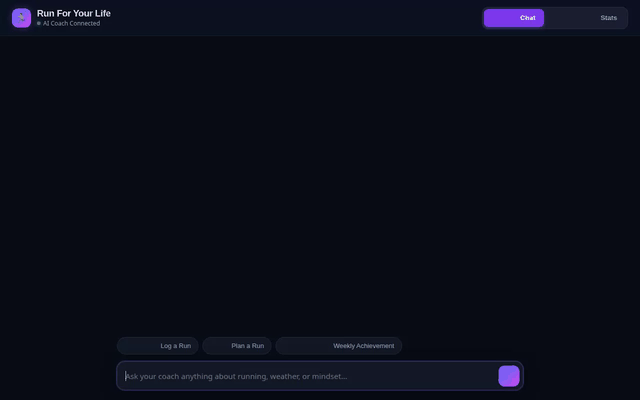

# 🏃 Run For Your Life — AI Running & Mindset Coach

An AI-powered running and mindset coaching agent built on Google's Agent Development Kit (ADK) and deployed to Vertex AI Agent Engine. It helps runners log workouts, track emotional state & mindset, discover nearby running spots, check live weather, calculate race splits in a Python sandbox, generate motivational AI artwork and video clips, and receive adaptive coaching advice.



---

## 🌟 Capabilities & Features

### 🏋️ Workouts & Mindset Tracking
- **Run Logging (`log_run`)**: Records run distance, duration, average pace, pre-run and post-run feelings (energetic, tired, calm, accomplished), and weather notes directly into Google Cloud Firestore.
- **Run History (`get_run_history`)**: Queries past running sessions stored in Firestore to analyze long-term training progress.
- **Mindset & Pattern Analysis (`analyze_mindset_and_patterns`)**: Evaluates emotional trends, fatigue patterns, and motivation across past runs to prevent burnout and injury.
- **Adaptive Workouts (`recommend_adaptive_workout`)**: Generates custom workout plans tailored to current fitness level, recent fatigue, and user goals.
- **Achievement Badges (`generate_achievement_badge`)**: Awards cute agile animal badges for milestones and consistency.

### 🎨 Multimodal Media Generation
- **Running Artwork (`generate_running_motivation_image`)**: Generates custom running motivation imagery using Google's `gemini-3.1-flash-lite-image` in the `global` region, saves it as an ADK artifact, and uploads it to a public Google Cloud Storage bucket.
- **Running Video Clips (`generate_running_motivation_video`)**: Generates short running video clips using Google's `gemini-omni-flash-preview` model via the Interactions API in the `global` region, saves it as an ADK artifact, and uploads it to Google Cloud Storage.

### 🗺️ Geolocation & Weather
- **Geocoding (`geocode_address`)**: Converts addresses or landmark names into exact latitude/longitude coordinates via Google Maps Geocoding API.
- **Nearby Spots (`search_nearby_places`)**: Finds nearby running parks, tracks, and trails using Google Maps Places API.
- **Outdoor Weather (`get_outdoor_running_weather`)**: Fetches temperature, humidity, wind speed, and weather codes to recommend optimal gear and hydration.

### 🧮 Math & Memory
- **Code Execution (`run_python_code`)**: Solves split calculations, Riegel race finish time projections, and Karvonen heart rate zones inside the isolated Agent Engine Python sandbox.
- **Long-Term Memory (`VertexAiMemoryBankService`)**: Persists runner preferences, goal distance, injury history, and coaching rapport across turns using Vertex AI Memory Bank.
- **Rich UI (`A2UI v0.8`)**: Generates structured, responsive UI cards rendered directly in the chat interface via A2UI Basic Catalog schema manager.

---

## ☁️ Google Cloud Services & Architecture

| Service | Role in Agent |
|---|---|
| **Vertex AI Agent Engine** | Serverless runtime hosting the ADK agent and `gemini-2.5-flash` model. |
| **Vertex AI Memory Bank** | Long-term memory storage service (`agentengine://...`). |
| **Google Cloud Firestore** | NoSQL database storing user run records and mindset logs. |
| **Google Cloud Storage** | Bucket (`gs://...`) storing public image and video assets. |
| **Google GenAI SDK (`global`)** | Powers `gemini-3.1-flash-lite-image` and `gemini-omni-flash-preview` models. |
| **Google Maps Platform** | Geocoding and Places API integration for location-aware coaching. |
| **Cloud Run** | Container runtime hosting the FastAPI proxy and Revolut-styled Web UI. |

---

## 🛠️ Project Structure

```
.
├── app/
│   ├── agent.py            # Main ADK Agent, tools, Memory Bank, and A2UI callbacks
│   ├── a2ui_utils.py       # A2UI response formatter and schema validation
│   └── fast_api_app.py     # FastAPI entrypoint for Agent Engine runtime
├── frontend/
│   ├── main.py             # FastAPI proxy server connecting browser to Agent Engine over A2A
│   ├── requirements.txt    # Frontend dependencies (fastapi, uvicorn, a2a-sdk)
│   ├── Dockerfile          # Container definition for Cloud Run deployment
│   └── static/
│       └── index.html      # Revolut/Apple-styled dark UI with A2UI card renderer & Stats dashboard
├── agents-cli-manifest.yaml # Agent manifest specification
├── pyproject.toml          # Python project dependencies
├── demo.gif                # Animated screen recording demo
└── README.md               # Project documentation
```

---

## 🚀 Local Setup & Running Instructions

### 1. Prerequisites
- Python 3.12 or newer
- `uv` package manager installed (`pip install uv`)
- Google Cloud CLI (`gcloud`) authenticated to your GCP project

### 2. Environment Variables
Create a `.env` file in the root directory:
```bash
GOOGLE_GENAI_USE_VERTEXAI=1
GOOGLE_CLOUD_PROJECT=your-gcp-project-id
GOOGLE_MAPS_API_KEY=your-google-maps-api-key
```

### 3. Running the Agent Engine Playground
To launch the agent locally with Memory Bank support:
```bash
uv run adk web . --port 8080 --reload_agents --memory_service_uri=agentengine://<MEMORY_BANK_ID>
```

### 4. Running the Web Frontend Locally
To run the Revolut-styled dark mode chat UI:
```bash
cd frontend
export AGENT_ENGINE_RESOURCE_NAME="projects/<PROJECT_ID>/locations/us-east1/reasoningEngines/<REASONING_ENGINE_ID>"
export AGENT_DIRECTORY="app"
export PORT="8080"
uv run python main.py
```
Then open your web browser to `http://localhost:8080`.

---

## 🧪 Running Unit Tests

Run the unit test suite to verify tool execution and agent logic:
```bash
uv run pytest
```
